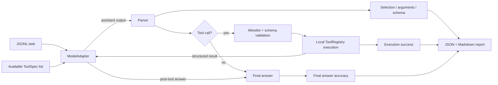

# ToolCall-Bench-Lite

[](https://github.com/senxichong/toolcall-bench-lite/actions/workflows/ci.yml)
[](https://www.python.org/)
[](LICENSE)

**A small, deterministic evaluation framework for LLM tool calling—from tool selection and arguments to execution and the final answer.**

ToolCall-Bench-Lite is deliberately narrow: standard-library runtime, five local tools, one tool step, transparent Boolean metrics, JSONL tasks, and JSON/Markdown reports. It is meant to be understood in an afternoon and extended without adopting a full agent platform.

## The 20-second example

```bash
python -m pip install -e ".[dev]"
toolcall-bench run benchmarks/demo.jsonl
```

```text
Completed 25 tasks with adapter 'mock'.
Overall success: 25/25 (100.0%)
JSON: runs/latest.json
Markdown: runs/latest.md
```

The default `MockAgent` is deterministic, reads only the prompt/tool schemas/results, and needs no API key or network. Its perfect demo score is a regression check that the framework is wired correctly—not evidence about a real LLM.

## Architecture



The parser is intentionally separate from adapters. Malformed model output becomes a scored failure rather than an exception that aborts the run. Tool calls are checked against each task's allowlist and JSON Schema before the Python function is reached.

## Quick Start

Requirements: Python 3.10 or newer.

```bash
git clone https://github.com/senxichong/toolcall-bench-lite.git
cd toolcall-bench-lite
python -m pip install -e ".[dev]"

# Run the deterministic offline demo and create both reports.
toolcall-bench run benchmarks/demo.jsonl

# Re-render Markdown from an existing JSON run.
toolcall-bench report runs/latest.json

# Quality checks used by CI.
ruff check .
pytest
```

You can also run the package without the console-script installation:

```bash
python -m toolcall_bench run benchmarks/demo.jsonl
```

### OpenAI-compatible endpoint

The optional adapter uses the standard library and an OpenAI-compatible `/chat/completions` endpoint. Configuration is environment-based; the project contains no key and never requires an external API for its default workflow.

```bash
export TOOLCALL_BENCH_MODEL="your-model"
export TOOLCALL_BENCH_BASE_URL="https://your-endpoint.example/v1"
export TOOLCALL_BENCH_API_KEY="your-key"

toolcall-bench run benchmarks/demo.jsonl --adapter openai-compatible
```

PowerShell uses `$env:TOOLCALL_BENCH_MODEL = "your-model"` (and the same pattern for the other variables). The API key has no CLI flag, which helps keep it out of shell history.

## Built-in tools

All tools are deterministic and local. Nothing accesses the internet.

| Tool | Arguments | Purpose |
|---|---|---|
| `calculator` | `expression: string` | Safely evaluates bounded arithmetic with Python AST; never calls `eval`. |
| `get_word_length` | `word: string` | Counts Unicode code points. |
| `convert_temperature` | `value`, `from_unit`, `to_unit` | Converts Celsius, Fahrenheit, and Kelvin. |
| `lookup_product` | `product_id: string` | Reads a fixed in-memory catalog. |
| `search_mock_database` | `query`, optional `category`, optional `limit` | Searches fixed local records. |

## Benchmark Format

Benchmarks are UTF-8 JSONL: one self-contained task per line.

```json
{"task_id":"calc_001","prompt":"What is 25 * 16?","available_tools":["calculator"],"expected_tool":"calculator","expected_arguments":{"expression":"25 * 16"},"expected_answer":"400","answer_match":"exact"}
```

| Field | Type | Meaning |
|---|---|---|
| `task_id` | string | Unique stable identifier. |
| `prompt` | string | User request shown to the model. |
| `available_tools` | string array | Per-task allowlist and distractor set. |
| `expected_tool` | string or `null` | Gold tool; `null` means the correct behavior is no call. |
| `expected_arguments` | object | Gold arguments; must be empty for a no-call task. |
| `expected_answer` | any JSON value | Gold final answer. Objects/arrays can be compared structurally. |
| `answer_match` | string | `auto`, `exact`, `json`, `numeric`, or `contains`. |
| `metadata` | object, optional | Dataset annotations not used for scoring. |

The bundled 25 tasks cover tool choice, distractor tools, argument extraction, missing required information, structured JSON, and requests that need no tool.

## Evaluation Metrics

Every task receives five independent Boolean metrics plus an all-or-nothing result:

| Metric | Pass condition |
|---|---|
| **Tool Selection Accuracy** | Called tool equals `expected_tool`; a correct no-call also passes. |
| **Argument Match** | Keys and nested structure match; numbers use a small tolerance and arithmetic expressions are compared as normalized ASTs. |
| **Schema Validity** | Assistant structure is parseable, tool is advertised, and arguments satisfy the tool's JSON Schema. |
| **Execution Success** | The selected local tool returns successfully; a correctly expected no-call passes. |
| **Final Answer Accuracy** | The answer passes the task's exact, normalized, numeric, contains, or structural JSON comparison. |
| **Overall Success** | All five metrics pass for that task. |

JSON reports preserve the expected/actual values, parser errors, tool errors, individual task traces, aggregate counts, and rates. Markdown is generated only from that JSON-compatible run object.

## Adding a New Tool

Define a normal Python function, describe its arguments with the supported JSON Schema subset, then register the pair:

```python
from toolcall_bench import ToolRegistry, ToolSpec


def reverse_text(text: str) -> str:
    return text[::-1]


registry = ToolRegistry().add(
    ToolSpec(
        name="reverse_text",
        description="Reverse a string.",
        parameters={
            "type": "object",
            "properties": {"text": {"type": "string"}},
            "required": ["text"],
            "additionalProperties": False,
        },
    ),
    reverse_text,
)
```

Pass the registry to `BenchmarkRunner(adapter, registry)`. See [`examples/custom_tool.py`](examples/custom_tool.py) for a runnable version. Prefer deterministic, side-effect-free functions in evaluation datasets.

## Adding a New Task

Append one valid JSON object to a benchmark file. The expected tool must appear in `available_tools`; use `null` and `{}` when asking for clarification or answering directly is correct.

```json
{"task_id":"word_005","prompt":"How many characters are in \"agent\"?","available_tools":["calculator","get_word_length"],"expected_tool":"get_word_length","expected_arguments":{"word":"agent"},"expected_answer":"5","answer_match":"exact"}
```

`load_tasks()` rejects malformed JSON, missing/unknown fields, duplicate IDs, duplicate tool names, and inconsistent no-call gold data with a source line number.

## Adding a New Model

Implement one provider-neutral method. Return a direct assistant message, an OpenAI-compatible response envelope, or a plain answer string; parsing stays inside the framework.

```python
from toolcall_bench import ModelAdapter


class MyAdapter(ModelAdapter):
    name = "my-model"

    def generate(self, messages, tools):
        provider_tools = [tool.to_openai_tool() for tool in tools]
        return my_client.complete(messages=messages, tools=provider_tools)
```

The runner calls the same method again after a tool result. Adapters should not read benchmark gold fields. They receive only messages and allowed `ToolSpec` objects.

## Results

The following numbers were produced locally with the committed `benchmarks/demo.jsonl` and deterministic `MockAgent` using the Quick Start command:

| Adapter | Tasks | Tool selection | Arguments | Schema | Execution | Final answer | Overall |
|---|---:|---:|---:|---:|---:|---:|---:|
| `MockAgent` | 25 | 25/25 | 25/25 | 25/25 | 25/25 | 25/25 | 25/25 |

This row is reproducible framework validation, not a comparative LLM experiment. No real-model metric is reported because none was run. Use each generated `runs/latest.json` as the source of truth for new results.

## Project Layout

```text
toolcall_bench/
  schemas.py    # typed tasks, traces, metric results, run reports
  tools.py      # registry, schema checks, five local tools
  tasks.py      # strict JSONL loading and writing
  agent.py      # ModelAdapter, MockAgent, OpenAI-compatible adapter
  parser.py     # provider-output normalization
  evaluator.py  # five metrics and overall success
  runner.py     # one-call execution loop
  report.py     # JSON-backed Markdown rendering
  cli.py        # run/report commands
benchmarks/demo.jsonl
examples/
tests/
docs/interview.md
```

## Limitations

- One tool call per task; parallel and multi-step trajectories are not yet executed.
- Only a practical JSON Schema subset is implemented, not the full specification.
- Final answers use deterministic comparators, not semantic or LLM-as-judge grading.
- Argument gold has one canonical call, so equally valid alternative plans are not represented.
- The built-in tools are tiny fixtures and do not model network latency, permissions, or changing data.
- The OpenAI-compatible adapter targets chat completions and may need a small subclass for provider-specific formats.

## Roadmap

- Multi-step and parallel tool-call trajectories with step budgets.
- Field-level partial credit and multiple acceptable gold calls.
- Async adapters, retries, timeouts, and richer provider diagnostics.
- Dataset versioning and benchmark slices/tags.
- Optional semantic answer graders with explicit judge provenance.
- Sandboxed connectors and side-effect policies for realistic agents.

## Development

```bash
ruff check .
pytest
```

GitHub Actions runs the same checks on pushes and pull requests. The project is available under the [MIT License](LICENSE).

